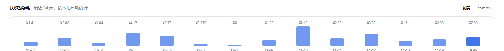

# dsh-token-usage

Live and historical token usage for every session in DeepSeek Harness — on one
dedicated page.



## What it does

- **A real page, not an overlay.** The plugin registers a global panel in the
  centre column, the same mechanism the Plugins page uses: opening it replaces
  the Conversation in the main slot instead of floating above it. Enter from the
  **Token usage** row in the sidebar and leave with **Back to chat** (or by
  opening any session).
- **Live.** Every durable session artifact is scanned incrementally — only the
  Zstandard frames appended since the previous poll are decoded. The page polls
  a same-origin route every two seconds and marks sessions that are still
  running with a green dot and a “running now” badge.
- **History.** A strip charts the last **7 / 14 / 30** local calendar days (the
  choice is remembered in `localStorage`); every session also keeps its own
  per-day buckets.
- **Sorting.** Click any header to toggle ascending / descending: session,
  model, input, output, cache read, cache write, total, spend, cache hit rate,
  last active. Search filters by session, workspace, model, or id; sessions
  without usage stay hidden until you ask for them.
- **Time windows.** The header selector switches the summary and the table
  between **today / last 7 days / last 30 days / all time**, recomputed from each
  session's own day buckets.
- **Trend badges.** Every summary card carries a small pill in its bottom-right
  corner — `▲56%` or `▼12%` — green when the change is good, red when it is not
  (more spend or tokens is red, a higher cache hit rate is green, flat is
  `→0pp`). Hovering shows both values: a selected window compares with the
  window before it, **all time** compares the latest 7 days with the 7 before,
  and the two “today” cards compare with yesterday.
- **Exports.** Three buttons above the table: **CSV · sessions** (the filtered, sorted
  table with raw integers and a UTF-8 BOM), **CSV · days** (daily totals for the
  selected range), and **Copy table** (a Markdown table ready to paste).
- **Three chart forms.** The history strip switches between **bars, line, and pie**
  (the choice is remembered) at one fixed height, so switching never jumps. Spend
  is split into **peak and off-peak**: a dashed peak line beside the off-peak area,
  two-tone stacked bars, or a two-slice donut. The header shows a
  **“Off-peak · 1h 30m left”** badge naming the window in force and the time until
  the next switch.
- **Inline daily detail.** The `▸` at the left of a session row expands that
  session's per-day bars for the selected range (spend when priced, tokens
  otherwise) with a `N days · tokens · spend` total; expanding never opens the
  session.
- **Box aggregation.** The grouping switch offers **workspace / box / none**. Box
  data is read-only from dsh-session-boxes' `/session-boxes`: a parent box contains
  its child boxes' sessions, ungrouped sessions come last, rows carry a
  `parent / child` label, and both CSV exports and the Markdown copy gain a Box
  column. A missing route, a 1.5 s timeout, or a malformed payload silently falls
  back to workspace grouping.
- **Workspace grouping and sub-sessions.** Rows group under their workspace with
  a subtotal; a subagent session folds into its parent as a chip
  (`1 sub-sessions · ¥1.22`) that expands inline. Grouping can be turned off.
- **Warm start.** The fold is cached in `~/.dsh/token-usage-cache.json` keyed by
  artifact size and modification time, so a restart reads no session logs at all
  (2.3 s cold → ~7 ms warm). Any changed file falls back to an incremental read.
- **Numbers that mean something.** Usage is folded exactly like the shipped
  `tokenUsage` projection: a final assistant settlement replaces the streaming
  sample of the same attempt, and a retried attempt is billed separately.
- **Estimated spend.** Every attempt is priced at the moment it happened, so the
  peak/off-peak window and the model of that request are honored: the built-in
  table uses DeepSeek's official CNY list prices (Flash `0.02 / 1 / 4`, Pro
  `0.15 / 4.5 / 13.5` per million cache-hit / miss / output tokens) with the
  Beijing peak window doubling every rate. Spend appears in the summary strip,
  as a sortable table column, and as the default history metric.

## Configuration

None.

### Overriding prices

The estimate is a reference figure, not a bill. Override the table by creating
`~/.dsh/token-usage-prices.json`:

```json
{
  "currency": "CNY",
  "symbol": "¥",
  "peakMultiplier": 2,
  "models": [
    { "match": "minimax", "cacheHit": 0.3, "cacheMiss": 3, "output": 9 },
    { "match": "deepseek-v4-pro", "cacheHit": 0.15, "cacheMiss": 4.5, "output": 13.5 }
  ],
  "fallback": { "cacheHit": 0.02, "cacheMiss": 1, "output": 4 },
  "holidays": ["2026-10-01", "2026-10-02"]
}
```

Rates are per million tokens in `currency`; `match` is a case-insensitive
substring of the provider model name, longest match first. Every field is
optional — omitted fields keep their built-in value. `holidays` are the days
that bill at the off-peak rate all day; add each new year's statutory holidays
there.

## Self-test

The plugin detail page (Settings → Plugins → dsh-token-usage) ends with a
**Self-test** block that runs **only when you press “Run self-test”** — nothing is
requested when the page merely opens:

| Check | Passes when |
| --- | --- |
| `/token-usage` returns 200 | the same-origin route answers with JSON |
| Re-request with the ETag returns 304 | the first response's ETag is accepted (read-only probe) |
| Chart container renders | an offscreen bar chart mounts and produces DOM |
| Pricing table readable | `payload.pricing` carries a currency and peak multiplier |

Each check has a 2 s timeout, failures show their reason inline, and **Copy
results** produces Markdown (`- [x] label — pass` / `- [ ] label — fail: reason`).

## Implementation

| File | Role |
| --- | --- |
| `index.js` | Host half: incremental Zstandard frame reader over `~/.dsh/sessions`, the usage fold, and the read-only `/token-usage` route. |
| `client.js` | Browser half: the global panel, summary strip, 7/14/30-day history strip, sortable table, exports, and polling. |

The Host half registers no tool and adds no prompt content; it serves one
read-only JSON route. Artifacts are decoded frame by frame, so a poll only reads
what the Host appended since the previous one; restarts, truncation, and a
half-written final frame each have their own handling.

Data colors come from the `--dshc-*` palette: `:root` carries the light set and
`body[data-ds-dark-theme]` overrides it with the dark one, so charts and the
peak/off-peak split never hardcode a hex value.

- **What it does not do.** The estimate prices uncached, cache-write, and cache-read
  prompt tokens from usage the provider reported; it does not read account
  balances, and it does not know a provider's private rates unless you override
  them.
- **304 uses size and modification time only.** The poll's `ETag` hashes each
  artifact's byte size and `mtime`. An external tool that rewrites a log in place
  to the same size and restores its original `mtime` could make a 304 serve stale
  content; the normal write path never does this, so no extra fingerprint is
  computed.

### Development

```bash
node test/host.test.mjs          # host fold, incremental reader, pricing (no third-party deps)
pnpm add -D jsdom react react-dom
node test/page.dom.test.mjs      # runs the shipped client.js in jsdom: sorting, search, states
```

## Install from GitHub

```sh
dsh plugin --profile desktop add github:879745uhjun/dsh-token-usage
```

Reload the Web UI page after installing.

## License

MIT.
