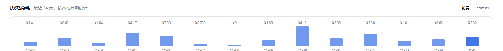

# dsh-token-usage

每个会话消耗了多少 token —— 实时看，也能翻历史，一个独立页面。



## 它做什么

- **是一个真正的页面，不是浮层。** 插件在中间栏注册了一个全局面板，和「插件」页用的是同一
  套机制：打开它就会替换主区域里的对话，而不是盖在对话上面，所以不存在遮挡、错位或滚动冲突。
   从左侧栏的 **Token 用量** 进入，点 **返回对话**（或直接点开任意会话）离开。
- **实时。** 每个会话的持久化日志被增量扫描：只解码上次之后新写入的 Zstandard 帧；页面每 2 秒
  轮询一次同源接口，正在运行的会话标题旁会亮起绿点和「正在运行」标记。
- **历史。** 顶部按本地日期统计最近一段时间的总消耗，可在 **7 / 14 / 30 天** 之间切换（选择记在
  `localStorage`）；每个会话还各自保留按天折叠的明细。
- **排序。** 点任意表头即可切换升序 / 降序：会话名、模型、输入、输出、缓存读、缓存写、总计、
  花费、缓存命中率、最后活动。搜索框按会话、工作区、模型或会话 ID 过滤；无消耗会话默认隐藏，可一键显示。
- **时间范围。** 顶部的选择器把汇总和表格切到 **今天 / 近 7 天 / 近 30 天 / 全部时间**，
  用每个会话自己的日桶重算。
- **涨跌徽标。** 每张汇总卡右下角有一个小胶囊：`▲56%` 或 `▼12%`，绿色表示变好、红色表示变差
  （花费/tokens 变多是红，缓存命中率变高是绿，持平是灰色 `→0pp`）。悬停能看对比的两个数值：
  选了窗口时对比等长的上一窗口，**全部时间**下对比近 7 天与前 7 天，今日两张卡对比昨日。
- **导出。** 会话表上方三个按钮：**CSV · 会话**（当前筛选与排序的会话，tokens 为原始整数、带 BOM）、
  **CSV · 按天**（所选时间范围的每日汇总）、**复制表格**（Markdown 表格，可直接贴进文档或 issue）。
- **三种图**：历史区可在 **柱状 / 折线 / 扇形** 之间切换（选择记忆），三种图共用同一固定高度，
  切换时不跳动；花费还会按 **峰时 / 谷时** 拆色显示（谷时实线 + 峰时虚线，或双色堆叠、峰谷两片）。
  顶栏另有「谷时 · 剩余 1h 30m」徽标，单独显示当前计价时段与距下次切换的剩余时间。
- **行内每日明细**：每个会话行左侧的 `▸` 展开该会话在当前时间范围内的每日柱状明细（有价格时按花费、
  否则按 tokens），顶部给出「N 天 · tokens · 花费」合计；展开不会打开会话。
- **按盒子归集**：分组维度可切换 **工作区 / 盒子 / 不分**。盒子数据只读自 dsh-session-boxes 的
  `/session-boxes`：父盒包含子盒成员、未分组排最后，行上显示 `父盒 / 子盒`；CSV 与 Markdown
  导出都带「盒子」列。该路由缺失、1.5 秒超时或返回异常时自动退回按工作区分组。
- **按工作区分组 + 子会话折叠。** 会话按工作区分组并给出小计；subagent 会话折进父会话，显示成
  `1 个子会话 · ¥1.22` 的小胶囊，点开就地展开。分组可以关掉。
- **秒开。** 折叠结果缓存在 `~/.dsh/token-usage-cache.json`，按日志大小与修改时间校验，
  重启时完全不读会话日志（冷启 2.3s → 热启约 7ms）。任何文件有变化就退回增量读取。
- **口径可信。** 用量按官方 `tokenUsage` 投影的规则折叠：同一步内最终的 assistant 结算会替换
  流式阶段的采样，而重试（`llm/retry-started`）会另记一次计费。
- **预估花费。** 每一次尝试都按它发生的时刻定价，所以峰谷时段和当次请求的模型都会被算进去：
  内置价目表用 DeepSeek 官方人民币价（Flash `0.02 / 1 / 4`、Pro `0.15 / 4.5 / 13.5`，单位是
  元/百万 token，依次为缓存命中 / 未命中 / 输出），北京时间的峰时窗把每一档都翻倍。花费出现在
  汇总卡、可排序的表格列，以及默认的历史统计口径里。

## 配置

无。装上即用。预估花费不是账单：它按模型上报的 usage 乘以价目表计算，不读取账户余额，也不保证
等于实际扣费。

### 覆盖单价

新建 `~/.dsh/token-usage-prices.json` 即可覆盖价目表：

```json
{
  "currency": "CNY",
  "symbol": "¥",
  "peakMultiplier": 2,
  "models": [
    { "match": "minimax", "cacheHit": 0.3, "cacheMiss": 3, "output": 9 },
    { "match": "deepseek-v4-pro", "cacheHit": 0.15, "cacheMiss": 4.5, "output": 13.5 }
  ],
  "fallback": { "cacheHit": 0.02, "cacheMiss": 1, "output": 4 },
  "holidays": ["2026-10-01", "2026-10-02"]
}
```

单价是「每百万 token、以 `currency` 计」；`match` 是模型名的大小写无关子串，最长匹配优先。
每个字段都可省略，省掉的沿用内置值。`holidays` 是全天按谷价计费的日期，每年新的法定节假日
补在这里。

## 自检

插件详情页（设置 → 插件 → dsh-token-usage）底部有「自检」区块，**只在点击「运行自检」时**执行，
不会在打开详情页时自动发请求：

| 检查 | 通过条件 |
| --- | --- |
| `/token-usage` 返回 200 | 同源路由可用并返回 JSON |
| 带 ETag 再请求返回 304 | 首次响应的 ETag 被接受（只读探测） |
| 图表容器可渲染 | 离屏挂载一个柱状图，确认 DOM 生成 |
| 价格表可读 | `payload.pricing` 含币种与峰时倍数 |

每条检查 2 秒超时；失败原因逐行显示；「复制结果」输出 Markdown
（`- [x] 标签 — 通过` / `- [ ] 标签 — 失败：原因`）。

## 实现

| 文件 | 职责 |
| --- | --- |
| `index.js` | 宿主端：`~/.dsh/sessions` 的增量 Zstandard 帧读取、用量折叠、`/token-usage` 只读路由。 |
| `client.js` | 浏览器端：全局面板、汇总卡、7/14/30 天历史条、可排序表格、导出和轮询。 |

宿主端不注册工具、不进入提示词，只提供一条只读 JSON 路由。会话日志按帧解码，所以每次轮询只
读取并解压宿主上次轮询之后追加的字节；同一个会话的重启、截断、写到一半的帧都有单独处理。

数据色统一走 `--dshc-*` 调色板：`:root` 是浅色八色，`body[data-ds-dark-theme]` 覆盖为深色八色，
图表与峰谷拆分都引用变量，代码里不出现 hex。

**已知限制（304 的边界）**：轮询用的 `ETag` 只由每个日志的字节数与 `mtime` 组成。如果外部工具
把日志原地改写成相同大小、并把 `mtime` 改回原值，304 可能让页面沿用旧内容；正常的追加写入不会
出现这种情况，所以没有再算额外的指纹。

### 开发

```bash
node test/host.test.mjs          # 宿主端：折叠、增量解析、价目表（无第三方依赖）
pnpm add -D jsdom react react-dom
node test/page.dom.test.mjs      # jsdom 里跑真实 client.js：排序、搜索、筛选、空/错状态
```

## 从 GitHub 安装

```sh
dsh plugin --profile desktop add github:879745uhjun/dsh-token-usage
```

装好后刷新 Web 页面。

## License

MIT。
